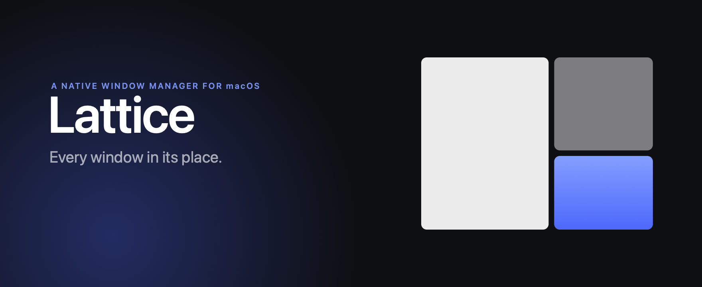

# Lattice

A native window manager for macOS. Every window in its place — on the Spaces you
already use.

No config file. No `brew install`. No emulated workspaces. One 6 MB app that you drag
to Applications and forget about, because it just works the way macOS works.



## What it does

**Tiles automatically.** Open a window and it gets a place. Close one and the rest
reflow. Nothing to arrange by hand.

**Uses your real Spaces.** Lattice reads the Space list straight from WindowServer.
Switching Spaces is the system switching Spaces — the same animation, the same
Mission Control, the same thumbnails. Windows on a Space you're not looking at are
never moved. There is no second, parallel idea of a workspace anywhere in the app.

**Six layouts, remembered per Space.** Dwindle, Columns, Rows, Grid, Master, Stack.
Each Space keeps its own layout and its own proportions.

**Keyboard first, mouse welcome.** Arrow/HJKL focus and move, drag a window to a screen
edge to snap it into the exact rectangle shown by the preview, ⌘-drag one window onto
another to trade places.

**A command palette, not a settings hunt.** ⌃⌥⌘K runs anything: layouts, Space moves,
window actions, or jump straight to a window by name.

**Every shortcut is yours.** Record any chord, see conflicts as you type, and hold
⌃⌥⌘/ to see the whole keyboard on screen.

## Install

```
./scripts/make-signing-identity.sh   # once: a stable local signing identity
./scripts/bundle.sh release
open build/Lattice.app
```

Drag `build/Lattice.app` into `/Applications`. First launch asks for Accessibility —
that permission is what lets any window manager move windows; Lattice reads window
frames and titles only, never window contents, and it has no network code.

The signing identity matters: an ad-hoc signature is pinned to the exact binary, so
macOS forgets the Accessibility grant after every rebuild. The script creates a
self-signed certificate in its own keychain (and prints the one `add-trusted-cert`
command needed to trust it once). After that, grants survive rebuilds. If the app ever
looks enabled in System Settings but says "Not granted", toggle Lattice off and on once.

## How it works

```
LatticeKit      Accessibility engine, Space introspection, layout maths
   WindowEngine    window discovery, frame writes, animation, notifications
   SpaceManager    real Spaces from WindowServer (SkyLight), native switching
   Tiler           per-Space tile order, commands, undo
   LayoutMath      pure functions: (count, rect, gap) -> [CGRect]
Lattice         SwiftUI app
   Overview        live map of your display, one tile per window
   Palette         fuzzy command runner
   HUD             snap preview and toasts
   Hotkeys         Carbon global shortcuts, drag-to-snap event tap
```

SIP stays enabled. Lattice never installs a helper, never asks you to disable
System Integrity Protection, and never replaces a system component.

## Keyboard

| Shortcut | Action |
|---|---|
| ⌥ H J K L | Focus left / down / up / right |
| ⇧⌥ H J K L | Move the window through the tile order |
| ⌥ ← → ↑ ↓ | Also move the window (alternate chords) |
| ⌥ 1–9 | Jump to a Space |
| ⇧⌥ 1–9 | Send the focused window to that Space |
| ⌃⌥ ← → | Previous / next Space |
| ⌥⌘ 1–6 | Dwindle · Columns · Rows · Grid · Master · Stack |
| ⌥ Space | Next layout |
| ⌥ F | Float / tile |
| ⇧⌥ F | macOS full screen |
| ⇧⌥ Z | Focus mode |
| ⌥ C | Centre |
| ⌥ ↩ | Zoom |
| ⌃⌥⌘ K | Command palette |
| ⌃⌥⌘ / | Every shortcut on screen |
| ⌃⌥⌘ P | Pause tiling |

Space keys are a real mapping: any key can point at any Space (⌥A for Space 3 is fine), and
you can add a second chord to any command. All of it lives in Settings ▸ Shortcuts.

Every one of them is rebindable in Settings ▸ Shortcuts, with live conflict detection.

## Notes

- Requires macOS 15 or later, Apple silicon or Intel.
- Windows that refuse to be resized (a few Java and Electron apps) are detected and
  treated honestly. By default Lattice keeps the layout you asked for and lets each app
  clamp its own size — windows can overlap, the same trade yabai makes. Settings ▸
  Layouts ▸ **Crowded Spaces** switches to “leave the Space untouched and say **Space
  full**” for people who would rather not see overlap.
- Moving another app's window to another Space is limited by macOS: with SIP on,
  WindowServer refuses cross-process moves and the system only offers the Mission Control
  drag. Lattice tries the native path first and, when it is refused, opens Mission Control
  with a “Drag *app* to Desktop N” instruction instead of failing silently.
- Each app's real floor is remembered per bundle id, so a restart does not have to
  learn it again.
- Logs live in `~/Library/Logs/Lattice/lattice.log`. `lattice doctor` (from the bundle's
  `Contents/Helpers/`, or on your PATH after `scripts/install-cli.sh`) explains why
  something is not working.
